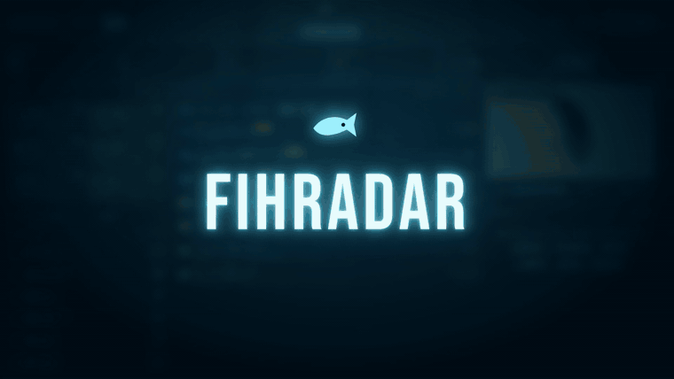
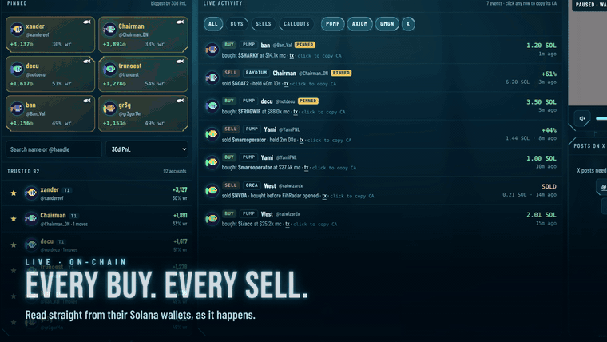
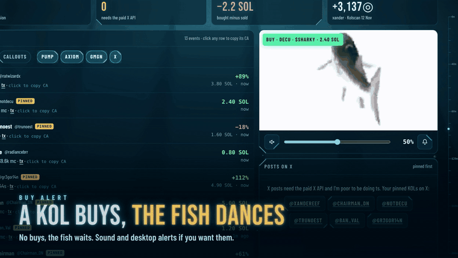
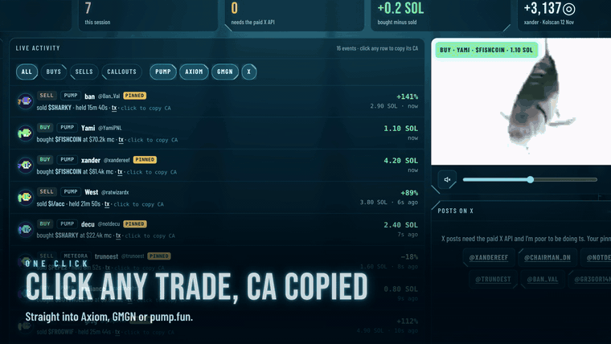
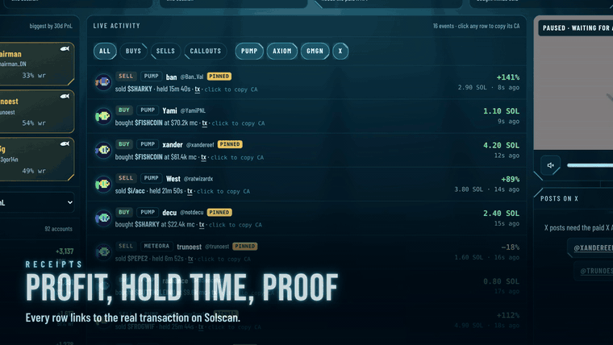
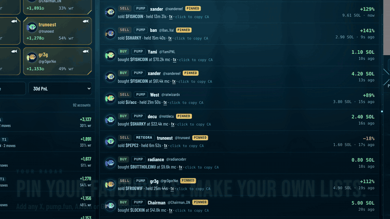
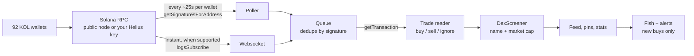

<div align="center">

# FIHRADAR

**watch everyone's favourite trader**

A live terminal that watches the wallets of 92 trusted memecoin KOLs and shows every buy and sell as it happens.
When a KOL buys, the funky town fish dances. No buys, the fish waits.

**[Download](https://github.com/0xF4ith/fihradar/archive/refs/heads/main.zip)** · **[Full trailer](docs/trailer.mp4)** · **[How it works](#how-it-works)** · **[My take](#my-take)**



</div>

---

## TL;DR

KOLs post the call. Their wallet already bought 10 minutes ago, and sometimes it's already selling while you read the tweet.

FihRadar skips the tweet and watches the wallet. Every buy and every sell from 92 KOLs, read straight off Solana, with profit, hold time and a Solscan link on every single row so you can check it yourself.

Free. No account. No install. No subscription. Nobody taking a cut. Download, double-click, it's live.

## Quick start

1. Click the green **Code** button, then **Download ZIP**, and unzip it.
2. Double-click `index.html`. Keep `fish.mp4` in the same folder.
3. Wait for the green `LIVE · ON-CHAIN` badge in the top right. The feed fills with each KOL's last few trades, then new ones come in live.

**Optional:** for faster updates, make a free account at [dashboard.helius.dev](https://dashboard.helius.dev), click the `LIVE · ON-CHAIN` badge and paste your API key. It stays in your browser.

---

## See it work

### Every buy. Every sell.



The middle column is the live feed. Each row is one real transaction from one KOL's wallet:

- **BUY / SELL** and **where** it happened (PUMP for pump.fun and PumpSwap, otherwise the DEX: Raydium, Meteora, Orca, Jupiter, LaunchLab)
- **who** traded, with a gold `PINNED` tag if they're one of your pinned KOLs
- **the token** and its market cap at that moment
- **how much SOL** went in or came out
- on sells, **profit %** and **how long they held**
- a **tx** link to the transaction on Solscan

Filter by buys, sells or platform with the chips on top.

### A KOL buys, the fish dances



Every new buy plays the funky town fish and shows who bought what. When nobody's buying, the fish stops and waits. Volume goes from 0 to 100%. Turn on the bell for desktop pop-ups when FihRadar is in the background.

Old trades loaded at startup never trigger the fish, so it only dances for things happening right now.

### Click any trade, CA copied



Click anywhere on a row and the token's contract address is on your clipboard. Paste it into Axiom, GMGN, pump.fun, Photon, whatever you use.

### Receipts



When FihRadar sees a KOL buy and then sell, it works out the profit % and hold time. Every row links to Solscan, so nothing here is "trust me bro". You can check every number yourself.

### Pin your favourites, make your own lists



- Star any KOL and they move into the gold boxes at the top, and their trades get the gold `PINNED` tag.
- Make your own lists with **+ New list**, and switch between them with the dropdown.
- Add any account with **+ Add**: an X handle, a pump.fun profile, an Axiom wallet or a GMGN wallet. You can also add people to the standard list.

---

## How it works

### The big picture



Everything runs in your browser. There is no FihRadar server. The only things your browser talks to are the Solana node (to read the KOL wallets) and DexScreener (for token names and market caps).

### 1. The KOL list

The standard list is **Trusted 92**, built from the research doc *"Trusted Memecoin KOLs: Axiom, Pump.fun, GMGN"* and Kolscan's 30-day leaderboard (snapshot from 12 Nov 2026). It's all in [`data/kols.json`](data/kols.json).

| | Count | What it means |
|---|---|---|
| Tier 1 | 22 | top of the leaderboard, big consistent PnL |
| Tier 2 | 25 | solid, profitable, active |
| Tier 3 | 45 | profitable, smaller size or newer |
| Left out | 10 | flagged in the research doc. Reasons are in the app under **Left out** |
| Removed | 8 | inactive: zero trades on Kolscan in the last 30 days |

The 30-day PnL and win/loss numbers are a snapshot. They change daily, so check Kolscan before you copy anyone.

### 2. Watching the wallets

There are two ways in, running at the same time:

- **Poller (always on).** FihRadar goes through the wallets one by one and asks the node for each one's latest transactions. On the free public node it asks every 260 ms, so with 92 wallets each one is checked about every **24 seconds**. With a Helius key it's every 150 ms, about every **14 seconds**.
- **Websocket (bonus).** It also subscribes to each wallet's activity. If the node pushes updates, trades show up within a couple of seconds. If not, the poller still catches everything.

Every transaction has a unique signature, so the same trade can never show up twice even if both paths catch it.

**First look vs live:** the first time a wallet is checked, its 4 most recent trades go in as history (no fish, no alerts). Anything after that is new. Anything older than 3 minutes is treated as history, even if it's only just been found.

### 3. Reading a trade

For each new transaction, FihRadar compares the wallet's balances before and after:

```js
sol   = SOL after - SOL before          // wrapped SOL counts as SOL
token = biggest change in any other token (USDC/USDT ignored)

if token went UP   and SOL went DOWN  -> BUY
if token went DOWN and SOL went UP    -> SELL
anything else                          -> ignored (transfers, airdrops, LP, fees)
moves smaller than 0.005 SOL           -> ignored (dust)
failed transactions                    -> ignored
```

The platform comes from which on-chain program the transaction used:

| Program | Shown as |
|---|---|
| pump.fun bonding curve | PUMP |
| PumpSwap | PUMP |
| Raydium AMM / CPMM / CLMM | RAYDIUM |
| Raydium LaunchLab | LAUNCHLAB |
| Meteora DLMM / DAMM / DBC | METEORA |
| Orca Whirlpools | ORCA |
| Jupiter | JUPITER |

Then FihRadar asks DexScreener for the token's name and market cap. It picks the pair with the most liquidity and caches it for 60 seconds.

### 4. Profit and hold time

FihRadar keeps a running position for every KOL and token it sees:

```
on BUY:  tokens += bought,  cost += SOL spent,  first buy time remembered
on SELL: share  = tokens sold / tokens held
         cost   = cost x share
         profit = SOL received / cost - 1
         hold   = sell time - first buy time
```

Partial sells work: sell half, and you get the profit on that half while the rest stays open.

If FihRadar never saw the buy (it happened before you opened the app), the sell still shows up, but says "bought before FihRadar opened" instead of a made-up profit.

### 5. Alerts

- **Fish:** plays on every new buy for about 6.5 seconds, then pauses. More buys keep it dancing.
- **Desktop pop-ups:** click the bell. They only fire when FihRadar is in the background, so you're not spammed while you're looking at it.
- **Sound:** browsers block sound until you click once on the page. After that the slider controls it.

### 6. Your data

Your lists, pins, volume and optional Helius key are saved in your browser (localStorage). Nothing is uploaded anywhere. There's no account, no analytics and no tracking.

---

## My take

**Why I built it.** Every KOL tweet is late by design. By the time the call is posted, the wallet bought minutes ago, and if the coin already ran, they're selling into your buy. I got tired of being someone's exit liquidity, so I built something that watches what they do, not what they say.

**How I actually use it:**

- **Two or three good wallets buying the same token close together is the signal.** One KOL buying means nothing. Three Tier 1 wallets aping the same CA in five minutes means pay attention.
- **Watch the sells harder than the buys.** A KOL buying is a maybe. A KOL dumping while their tweet is still going viral tells you everything.
- **Hold time tells you who you're dealing with.** Someone who holds 40 seconds is a scalper, and you're not getting their entries. Someone who holds 30 minutes plus you can actually follow.
- **Size matters.** A 0.3 SOL buy from someone who usually goes 10 SOL is a test, not a conviction play.
- **Pin 5 to 8 people, not 50.** Learn how they trade. The gold boxes are there for a reason.
- **Never copy blind.** Look at the chart, check liquidity, check the holders. FihRadar tells you where to look, not what to buy.

**Hot takes:**

- Most "callers" make more from their followers than from the coins. The wallet doesn't lie, the tweet does.
- 30-day PnL beats all-time PnL. Anyone can have one lucky month two years ago.
- If a KOL is good, you'll see it in their sells, not their buys.

## FAQ

**Is it actually live?**
Yes. The buys and sells come straight from the KOLs' wallets on Solana. Click **tx** on any row and Solscan shows you the same transaction. On the free node expect up to about 25 seconds of delay.

**Does it trade for me?**
No. It's a radar, not a bot. It never touches your wallet and never asks for a key or a seed phrase.

**Why does it say RAYDIUM or METEORA instead of Axiom or GMGN?**
Axiom, GMGN, Photon and the rest are front ends. On-chain they all trade through the same pools, so the blockchain shows the pool, not the app the KOL clicked in.

**Where are the X posts?**
The X API costs money and has no free tier, and I'm poor to be doing ts. That panel links to your pinned KOLs' X profiles instead.

**Can I watch my own wallets or friends' wallets?**
Yes. **+ Add** any Solana wallet as an Axiom or GMGN account and it gets watched like everyone else.

**Why didn't someone make the list?**
Either they're in **Left out** with a reason, they had no trades in the last 30 days, or they weren't in the research doc. Add them yourself with **+ Add**.

## What it can't do (yet)

- **X posts and callouts.** That needs the paid X API.
- **App labels.** It can't tell Axiom from GMGN on-chain.
- **Side wallets.** Only the wallets in the list are watched.
- **Instant updates on the free node.** Expect up to about 25 seconds.
- **Profit on old buys.** It only knows the profit when it saw the buy.

## Files

```
index.html        the whole app (one file)
fish.mp4          the funky town fish
data/kols.json    the KOL list: names, X handles, wallets, Kolscan stats, who was left out and why
docs/gifs/        the GIFs in this README
docs/trailer.mp4  the full trailer
docs/*.jpg        screenshots
```

*The GIFs and trailer use example trades so every feature shows up at once. The KOLs, their wallets and their 30-day stats are real.*

## Disclaimer

This is a watchlist, not financial advice. Copying a KOL's public wallet doesn't mean you'll get their results, and they might be exiting into your buy. Memecoins can go to zero in minutes. Only trade what you can afford to lose.

---

<div align="center">

built by [@0xF4ith](https://x.com/0xF4ith)

</div>
