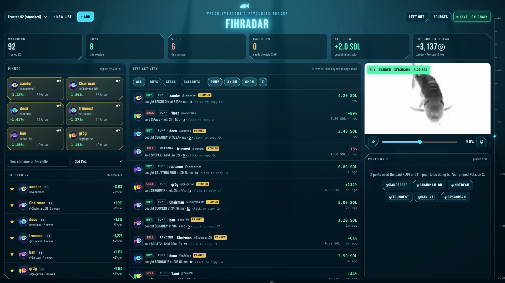
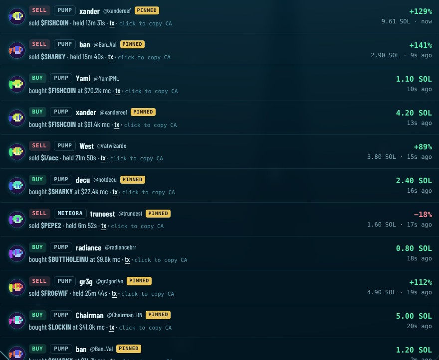
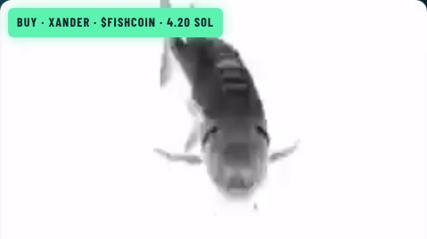
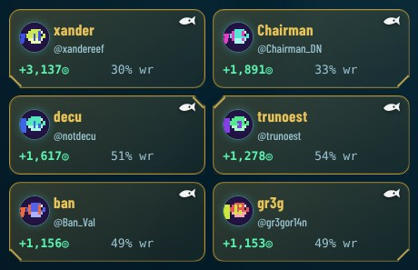

<div align="center">

# FIHRADAR

**watch everyone's favourite trader**

A live terminal that watches the wallets of 92 trusted memecoin KOLs and shows every buy and sell as it happens.
When a KOL buys, the funky town fish dances. No buys, the fish waits.

**[Download](https://github.com/0xF4ith/fihradar/archive/refs/heads/main.zip)** · **[Watch the trailer](docs/trailer.mp4)**



</div>

---

## What it does

- **92 trusted memecoin KOLs**, ranked by real 30-day PnL from Kolscan. Ruggers and paid shillers are left out (see "Left out" inside the app).
- **Live buys and sells**, read straight from each KOL's Solana wallet. No screenshots, no "trust me bro", just what they did with their money.
- **Profit %, hold time and proof** on every trade. Each row links to the real transaction on Solscan.
- **One click copies the CA.** Click any trade and the token's contract address is on your clipboard, ready for Axiom, GMGN or pump.fun.
- **Pin your favourites.** Pinned KOLs get gold boxes at the top.
- **Make your own lists.** Add any X, pump.fun, Axiom or GMGN account, or add them to the standard list.
- **The fish.** A KOL buys, the funky town fish plays. Volume slider from 0 to 100%, plus optional desktop alerts.

## How to use it

1. Click the green **Code** button, then **Download ZIP**, and unzip it.
2. Double-click `index.html`. Keep `fish.mp4` in the same folder.
3. It connects by itself. Wait for the green `LIVE · ON-CHAIN` badge in the top right.

That's it. No account, no install, no subscription.

**Optional: faster updates**
By default each wallet is checked about every 25 seconds through a free public Solana node. For faster updates, make a free account at [dashboard.helius.dev](https://dashboard.helius.dev), click the `LIVE · ON-CHAIN` badge and paste your API key. The key stays in your browser only.

## Screenshots

| Live feed | Buy alert |
|---|---|
|  |  |

| Pinned KOLs |
|---|
|  |

*Screenshots and the trailer use example trades so every feature shows up at once. The KOLs and their 30-day stats are real.*

## How it works

```
KOL wallets (92) ──> Solana RPC ──> FihRadar reads each transaction
                    (public node      ├─ token in + SOL out  = BUY
                     or your Helius)  ├─ token out + SOL in  = SELL
                                      └─ everything else     = ignored
DexScreener ──> token name + market cap
Kolscan     ──> 30-day PnL, wins/losses (snapshot in data/kols.json)
```

- Wallets are polled in rotation with `getSignaturesForAddress`, and new transactions are parsed with `getTransaction`. A websocket subscription runs alongside for instant updates where the node supports it.
- On first load you see each KOL's last few trades as history. Anything new after that triggers the fish and alerts.
- Profit % and hold time are worked out when FihRadar has seen both the buy and the sell.
- Everything runs in your browser. There is no server, no tracking and nothing to log in to. Your lists and pins are saved in your browser.

## What it can't do (yet)

- **X posts and callouts** need the paid X API, which has no free tier. That panel links to the KOLs' X profiles instead.
- **Axiom vs GMGN.** On-chain, both trade through the same pools, so trades show the exchange used (pump.fun, Raydium, Meteora, Orca, Jupiter) instead of the app.
- **Side wallets** don't show up, only the wallets listed in `data/kols.json`.
- **Not instant.** Expect up to about 25 seconds of delay on the free public node.

## Files

```
index.html        the whole app (one file)
fish.mp4          the funky town fish
data/kols.json    the KOL list: names, X handles, wallets, Kolscan stats, who was left out and why
docs/             screenshots and the trailer
```

## Disclaimer

This is a watchlist, not financial advice. Copying a KOL's public wallet does not mean you'll get their results. They might be exiting into your buy. Memecoins can go to zero in minutes. Trade with money you can afford to lose.

---

<div align="center">

built by [@0xF4ith](https://x.com/0xF4ith)

</div>
